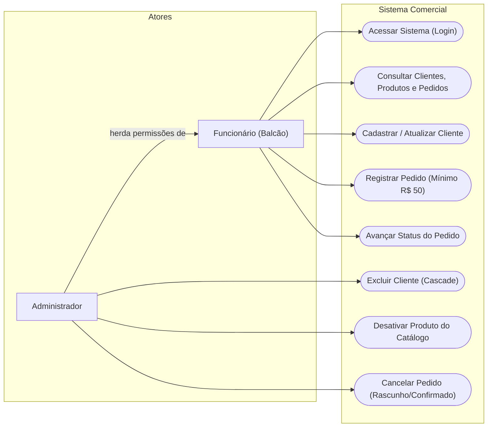
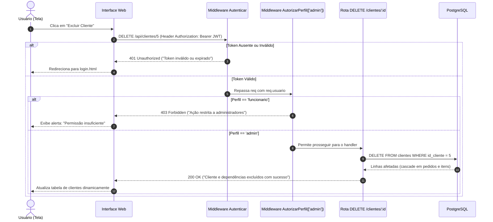
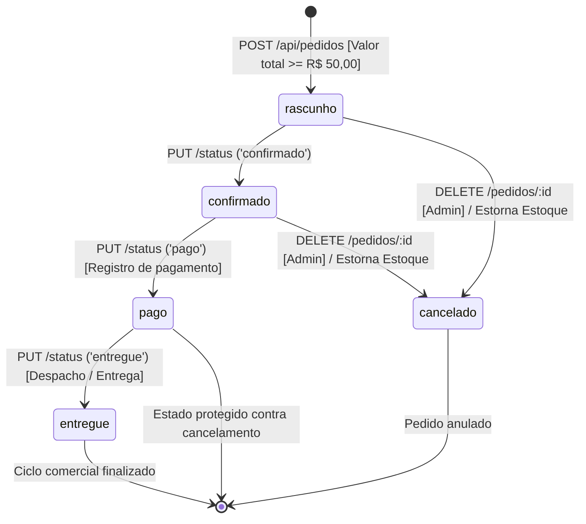
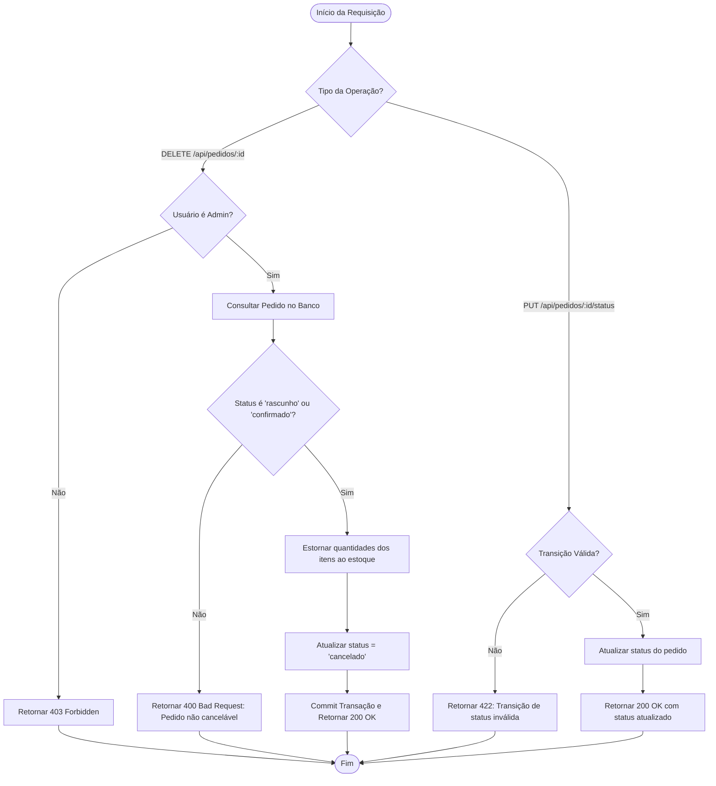

# Relatório de Engenharia de Software: Análise de Manutenção e Atualização da Modelagem

**Projeto:** Sistema Comercial de Balcão e Controle de Pedidos  
**Equipe:** Grupo de 3 Estudantes (Engenharia de Software)  
**Data:** 16 de Novembro de 2026  

---

## Sumário Executivo

Este documento apresenta uma análise aprofundada das inconsistências, defeitos de implementação e divergências entre a especificação documental (`README.md`), o modelo de dados relacional (`database/sql.sql`), as regras de negócio e o código-fonte (`src/` e `public/`) do repositório **Sistema Comercial**.

O trabalho está estruturado em três eixos principais:
1. **Identificação e Classificação dos Tipos de Manutenção:** Mapeamento exaustivo dos problemas encontrados no repositório, classificados sob a taxonomia da norma ISO/IEC 14764 e literatura de Engenharia de Software (Manutenções Corretiva, Adaptativa, Perfectiva e Preventiva).
2. **Análise de Impacto na Modelagem:** Seleção de dois cenários críticos para avaliar seus desdobramentos sobre requisitos funcionais/não funcionais, regras de negócio, artefatos UML e comportamento operacional.
3. **Atualização da Modelagem:** Especificação formal dos novos requisitos, regras de negócio revisadas, diagramas UML atualizados (Casos de Uso, Sequência, Estados e Atividades) e protótipos visuais de interface.

---

# 1. Identificação dos Tipos de Manutenção

A partir da inspeção estática do código, dos scripts SQL e da especificação técnica, foram identificadas **10 situações de erro e divergência**. A seguir, cada uma é descrita com sua classificação, justificativa técnica e componentes afetados.

---

### Situação 1: Violação de Integridade Referencial na Exclusão de Clientes (Ausência de Cascade)
* **Problema ou necessidade identificada:**  
  O requisito `RF05` e o modelo de dados estabelecem que a exclusão de um cliente deve remover em cascata todos os pedidos a ele vinculados e, subsequentemente, os itens desses pedidos. No entanto, no script DDL (`database/sql.sql`), a chave estrangeira em `pedidos (id_cliente)` foi declarada sem a cláusula `ON DELETE CASCADE`. Na rota `DELETE /api/clientes/:id` (`src/routes.js`), ao tentar excluir um cliente que possui histórico de compras, o PostgreSQL dispara o erro de chave estrangeira `23503`, interceptado pela API para retornar status `409 Conflict`, travando a operação e violando a especificação funcional.
* **Tipo de manutenção:** **Corretiva**.
* **Por que é o mais adequado:**  
  Trata-se do conserto de uma falha de implementação e modelagem relacional que impede o sistema de cumprir o comportamento funcional previamente especificado no projeto (`RF05`).
* **Partes do sistema afetadas:**  
  - Banco de Dados: Definição da tabela `pedidos` (necessidade de constraint com `ON DELETE CASCADE`).
  - Backend: Rota `DELETE /api/clientes/:id` em `src/routes.js` e tratamento de erros.
  - Modelagem: Diagrama relacional e modelo físico de dados.

---

### Situação 2: Ausência de Controle de Acesso Baseado em Perfis (RBAC) nas Operações Críticas
* **Problema ou necessidade identificada:**  
  Os requisitos `RF02` e `RN01` determinam que apenas usuários com perfil `admin` têm permissão para excluir clientes, desativar produtos e cancelar pedidos; tentativas realizadas por usuários com perfil `funcionario` devem ser terminantemente bloqueadas com status `403 Forbidden`. Na prática, o middleware de autenticação (`src/auth.js`) apenas valida a assinatura do token JWT, e os endpoints `DELETE /api/clientes/:id`, `DELETE /api/produtos/:id` e `PATCH /api/pedidos/:id/cancelar` em `src/routes.js` não inspecionam o atributo `req.usuario.perfil`. Consequentemente, qualquer funcionário autenticado pode realizar operações destrutivas. Adicionalmente, o frontend exibe os botões de ação para todos os usuários indistintamente.
* **Tipo de manutenção:** **Corretiva** (com caráter crítico de Segurança da Informação).
* **Por que é o mais adequado:**  
  Representa a correção de uma vulnerabilidade de segurança e desvio grave de especificação funcional, onde regras de negócio de autorização foram completamente omitidas na camada de controle.
* **Partes do sistema afetadas:**  
  - Backend: Criação de middleware de autorização (`autorizarPerfil(['admin'])`) e proteção das rotas em `src/routes.js`.
  - Frontend: Lógica de renderização de botões e ações em `public/script.js` e marcações em `public/index.html`.
  - Requisitos e Documentação: Especificação da matriz de controle de acesso (RBAC).

---

### Situação 3: Inconsistência Crítica entre a Regra de Estoque Negativo e as Restrições de Sistema
* **Problema ou necessidade identificada:**  
  O requisito `RF08` e a regra `RN05` preveem que *"Se a quantidade pedida for maior que o saldo, o pedido é aceito mesmo assim e o estoque do produto fica negativo até uma reposição posterior"*. Contudo, o sistema possui três bloqueios conflitantes:
  1. No banco (`sql.sql`): `estoque INTEGER NOT NULL DEFAULT 0 CHECK (estoque >= 0)`;
  2. No backend (`src/routes.js`, linha 393): `if (dadosProduto.estoque < quantidade) throw new Error(...)`;
  3. No frontend (`public/script.js`, linha 384): `if (quantidadeTotal > produto.estoque) { ... return; }`.  
  O sistema aborta transações de venda a descoberto, impossibilitando a operação comercial pretendida pela diretoria.
* **Tipo de manutenção:** **Corretiva / Adaptativa de Regras**.
* **Por que é o mais adequado:**  
  Elimina contradições lógicas internas entre camadas arquiteturais (Banco, Servidor e Cliente) frente à regra de negócio corporativa deliberada no `README.md`.
* **Partes do sistema afetadas:**  
  - Banco de Dados: Remoção do `CHECK (estoque >= 0)` em `produtos`.
  - Backend: Remoção da exceção de bloqueio em `src/routes.js` durante a criação do pedido.
  - Frontend: Ajuste da validação de formulário em `public/script.js` para permitir adições com saldo insuficiente.

---

### Situação 4: Inconsistência no Ciclo de Vida do Pedido (Máquina de Estados e Endpoints Inexistentes)
* **Problema ou necessidade identificada:**  
  O `README.md` documenta uma máquina de estados com cinco status (`rascunho`, `confirmado`, `pago`, `entregue`, `cancelado`), manipulados por `PUT /api/pedidos/:id/status` e cancelamento restrito por `DELETE /api/pedidos/:id`. No entanto:
  - O banco (`sql.sql`) restringe a `CHECK (status IN ('aberto', 'pago', 'cancelado'))` e define o padrão como `'aberto'`;
  - A rota `PUT /api/pedidos/:id/status` inexiste em `src/routes.js`;
  - O cancelamento foi implementado via `PATCH /api/pedidos/:id/cancelar` e permite cancelar pedidos que já estão com status `'pago'`, violando frontalmente a regra `RN06` (*"Pedido pago ou entregue não pode ser cancelado"*).
* **Tipo de manutenção:** **Corretiva**.
* **Por que é o mais adequado:**  
  Reestabelece a integridade do processo nuclear da aplicação (o ciclo de vendas), ajustando a estrutura do banco e construindo as rotas RESTful conforme o contrato de interface original.
* **Partes do sistema afetadas:**  
  - Banco de Dados: `ALTER TABLE pedidos` alterando a constraint de status.
  - Backend: Criação da rota `PUT /status`, correção da rota de cancelamento para `DELETE` e imposição da guarda de cancelamento (`status IN ('rascunho', 'confirmado')`).
  - Frontend: Interface de seleção e avanço de status do pedido em `index.html` e `script.js`.

---

### Situação 5: Ausência de Validação do Valor Mínimo do Pedido (R$ 50,00)
* **Problema ou necessidade identificada:**  
  Os requisitos `RF08` e `RN04` impõem que todo pedido deve atingir um valor total mínimo de R$ 50,00 para ser registrado no balcão. No backend (`src/routes.js`, endpoint `POST /api/pedidos`), o valor total é calculado em centavos, mas nenhuma validação `if (valorTotalCentavos < 5000)` é executada antes do commit da transação, permitindo pedidos de R$ 1,00 ou R$ 10,00.
* **Tipo de manutenção:** **Corretiva**.
* **Por que é o mais adequado:**  
  Corrige a omissão de uma validação de regra de negócio elementar na camada de serviços da API.
* **Partes do sistema afetadas:**  
  - Backend: `POST /api/pedidos` em `src/routes.js` com retorno de erro HTTP 400 em caso de descumprimento.
  - Frontend: Validação prévia em `public/script.js` e exibição de alerta informativo ao operador.

---

### Situação 6: Ausência Completa do Módulo de Auditoria (RNF06 e Diagrama de Classes)
* **Problema ou necessidade identificada:**  
  O requisito `RNF06`, o Diagrama de Classes UML e a tabela de endpoints do `README.md` estipulam a existência da entidade `auditoria` (`id_auditoria`, `id_usuario`, `acao`, `data_hora`, `detalhe`) para rastrear todas as criações, atualizações e exclusões de registros, com consulta em `GET /api/auditoria`. Essa funcionalidade foi completamente omitida: a tabela não existe no script SQL, não há persistência de logs nas rotas e o endpoint correspondente inexiste.
* **Tipo de manutenção:** **Perfectiva / Evolutiva**.
* **Por que é o mais adequado:**  
  Consiste na implementação de um subsistema de governança, conformidade e rastreabilidade que agrega valor e qualidade operacional ao software, completando os requisitos arquiteturais previstos.
* **Partes do sistema afetadas:**  
  - Banco de Dados: Criação da tabela `auditoria` no PostgreSQL.
  - Backend: Módulo auxiliar de log de auditoria em `src/` acionado em todas as mutações de dados e criação da rota `GET /api/auditoria`.
  - Frontend: Nova tela ou visualizador de histórico de auditoria para o administrador.

---

### Situação 7: Omissão de Paginação nas Consultas de Entidades (RNF04)
* **Problema ou necessidade identificada:**  
  O requisito `RNF04` define que as consultas de clientes, produtos e pedidos devem suportar paginação via parâmetros `page` e `limit` (padrão de 10 registros por página), acompanhadas de botões de navegação no frontend. No código atual, todas as consultas realizam `SELECT *` sem `LIMIT`/`OFFSET`, provocando sobrecarga de memória e latência de rede à medida que a massa de dados cresce.
* **Tipo de manutenção:** **Perfectiva**.
* **Por que é o mais adequado:**  
  Otimiza o consumo de recursos computacionais, melhora o tempo de resposta e aperfeiçoa a ergonomia da interface, garantindo escalabilidade.
* **Partes do sistema afetadas:**  
  - Backend: Rotas `GET /clientes`, `GET /produtos` e `GET /pedidos` para aceitar query parameters e retornar metadados (`total`, `page`, `totalPages`).
  - Frontend: Componentes de paginação (botões "Anterior", "Próximo" e indicador numérico) em `public/index.html` e controle de estado em `public/script.js`.

---

### Situação 8: Painel Inicial (Dashboard) Desprovido de Métricas Operacionais
* **Problema ou necessidade identificada:**  
  A seção introdutória do projeto estipula que a tela inicial deve apresentar um resumo com três indicadores operacionais chave: total de clientes cadastrados, quantidade de produtos ativos em estoque e faturamento consolidado do mês corrente. No entanto, `index.html` exibe apenas três cartões estáticos de navegação, sem carregar nem apresentar nenhuma métrica de negócio.
* **Tipo de manutenção:** **Perfectiva**.
* **Por que é o mais adequado:**  
  Aprimora o valor de negócio do produto de software através da disponibilização de inteligência operacional para a gestão do lojista.
* **Partes do sistema afetadas:**  
  - Backend: Novo endpoint agregador `GET /api/dashboard/indicadores` executando queries consolidadas (`COUNT`, `SUM`).
  - Frontend: Atualização do template em `public/index.html` e rotinas de preenchimento assíncrono em `public/script.js`.

---

### Situação 9: Incompatibilidade de Porta do Servidor e Ausência de Protocolo Seguro HTTPS (RNF03 / RNF07)
* **Problema ou necessidade identificada:**  
  O requisito `RNF03` especifica que, na ausência da variável `PORT`, o servidor deve escutar na porta `8080`, mas `src/server.js` define fallback para `3000`. Além disso, o requisito `RNF07` exige que toda a comunicação, inclusive em desenvolvimento, opere sobre o protocolo HTTPS. A aplicação atual sobe um servidor HTTP desprotegido.
* **Tipo de manutenção:** **Adaptativa**.
* **Por que é o mais adequado:**  
  Adequa o software às exigências do ambiente de infraestrutura, padronização de portas de rede corporativas e conformidade mandatória com protocolos de transporte criptografado (TLS/HTTPS).
* **Partes do sistema afetadas:**  
  - Infraestrutura/Servidor: Arquivo `src/server.js` (uso do módulo nativo `https` com certificados locais autoassinados e correção da porta padrão para `8080`).
  - Configuração: Arquivo `.env`.

---

### Situação 10: Divergência Crítica entre Credenciais/Algoritmo Documentados vs Implementados (RNF02)
* **Problema ou necessidade identificada:**  
  O manual documenta que as senhas são `admin123` e `func123`, armazenadas como SHA-256 sem salt (`RNF02`). No entanto, o script `sql.sql` utiliza a extensão `pgcrypto` com algoritmo Blowfish/Bcrypt (`gen_salt('bf', 10)`) e gravou senhas distintas: `Admin123!` para o administrador e `123456` para Carlos Silva. Além disso, a rota `/login` compara com a biblioteca `bcryptjs`. O operador que tentar entrar com as credenciais do manual sofrerá rejeição imediata de credenciais.
* **Tipo de manutenção:** **Preventiva / Corretiva**.
* **Por que é o mais adequado:**  
  Trata-se do alinhamento da documentação e sementes de banco mantendo as boas práticas de segurança cibernética (o uso de Bcrypt com salt é muito superior a SHA-256 sem salt, prevenindo ataques por Rainbow Tables), corrigindo inconsistências de credenciais de demonstração.
* **Partes do sistema afetadas:**  
  - Documentação: Atualização do `README.md` (`RNF02` e tabela de credenciais).
  - Banco de Dados: Script de seed `database/sql.sql` sincronizado com senhas conhecidas e documentadas.

---

# 2. Análise de Impacto na Modelagem

Conforme a orientação metodológica, a equipe selecionou **duas situações críticas** que possuem impacto estrutural e funcional direto sobre o domínio da aplicação:

1. **Situação A (Selecionada):** *Controle de Acesso Baseado em Perfis (RBAC - Admin vs. Funcionário) com Proteção de Rotas e Renderização Condicional* (Situação 2);
2. **Situação B (Selecionada):** *Reestruturação do Ciclo de Vida do Pedido (Máquina de Estados, Valor Mínimo de R$ 50,00 e Regras de Cancelamento)* (Situações 4 e 5).

---

## Situação Escolhida 1: Controle de Acesso Baseado em Perfis (RBAC)

### 2.1 Requisitos Funcionais e Não Funcionais Alterados/Adicionados
* **RF02 (Alterado) — Controle de Acesso e Operações por Perfil:**  
  O sistema deve diferenciar estritamente as ações permitidas para os perfis `admin` e `funcionario`:
  - **Administrador:** Acesso irrestrito a consultas, cadastros, alterações, exclusão de clientes, desativação de produtos e cancelamento de pedidos.
  - **Funcionário:** Acesso permitido apenas para consultas, cadastros de clientes e pedidos, e edição de dados cadastrais. Tentativas de exclusão de cliente, desativação de produto ou cancelamento de pedido devem ser rejeitadas pelo backend com HTTP `403 Forbidden`.
* **RF02.1 (Adicionado) — Apresentação Condicional da Interface:**  
  A interface com o usuário deve inspecionar as permissões do usuário logado (armazenadas no token JWT decodificado) e ocultar ou desabilitar visualmente os botões de exclusão, desativação e cancelamento quando o perfil for `funcionario`.
* **RNF02.1 (Adicionado) — Princípio do Menor Privilégio na Camada de Serviço:**  
  A autorização deve ser validada obrigatoriamente no nível dos controladores de rota da API, independente de qualquer ocultação visual da interface, garantindo que requisições forjadas via cURL ou Postman sejam interceptadas.

### 2.2 Regras de Negócio Afetadas
* **RN01 (Revisada) — Matriz de Segregação de Funções:**
  - Operações destrutivas ou de cancelamento financeiro são de competência exclusiva do Administrador.
  - Funcionários não podem remover clientes cadastrados, inativar produtos do catálogo de vendas nem reverter pedidos já formalizados.

### 2.3 Diagramas, Fluxos e Documentos que Precisam ser Atualizados
* **Diagrama de Casos de Uso:** Decomposição dos atores genéricos em atores especializados (`Administrador` e `Funcionário`), com herança e delimitação de casos de uso exclusivos.
* **Diagrama de Sequência do Backend:** Inserção do middleware `autorizarPerfil(['admin'])` entre a autenticação do token e o controlador da rota em endpoints protegidos.
* **Especificação da API (OpenAPI/Swagger / README):** Documentação explícita do código HTTP `403 Forbidden` para `DELETE /api/clientes/:id`, `DELETE /api/produtos/:id` e `DELETE /api/pedidos/:id`.

### 2.4 Como Deverá Funcionar o Sistema Após a Alteração
1. Ao efetuar login com sucesso, a API emite o JWT assinado contendo as claims `{ id_usuario, nome, perfil }`.
2. A tela armazena esses dados e avalia o perfil:
   - Se for `funcionario`, a interface injeta classes utilitárias que ocultam os botões de ação sensíveis (Excluir Cliente, Desativar Produto, Cancelar Pedido) e exibe um distintivo "Perfil: Funcionário" no topo da página.
   - Se for `admin`, todos os botões de controle permanecem visíveis.
3. Caso um usuário mal-intencionado execute uma chamada direta `DELETE /api/clientes/1` enviando o token de funcionário, o middleware intercepta a requisição antes de atingir o banco de dados, encerra o processamento e devolve payload JSON padronizado: `403 Forbidden` (`{ "mensagem": "Acesso não autorizado para o perfil do usuário" }`).

---

## Situação Escolhida 2: Reestruturação do Ciclo de Vida do Pedido e Regras de Negócio

### 2.1 Requisitos Funcionais e Não Funcionais Alterados/Adicionados
* **RF08 (Alterado) — Registro e Gestão do Pedido:**  
  O pedido inicia obrigatoriamente no status `rascunho`. Deve conter um cliente válido e pelo menos um produto. O valor total consolidado deve ser igual ou superior a R$ 50,00. Caso o valor seja inferior, o registro é impedido com HTTP `400 Bad Request`.
* **RF09 (Adicionado) — Transição Formal de Status do Pedido:**  
  O sistema deve fornecer o endpoint `PUT /api/pedidos/:id/status` para promover o status estritamente de acordo com a máquina de estados: `rascunho -> confirmado -> pago -> entregue`. Saltos inválidos de estado devem ser rejeitados com HTTP `422 Unprocessable Entity`.
* **RF10 (Adicionado) — Cancelamento Seguro de Pedido:**  
  O cancelamento deve ser acionado via `DELETE /api/pedidos/:id`. Somente pedidos nos status `rascunho` ou `confirmado` podem ser cancelados. O cancelamento estorna integralmente as quantidades dos itens para o estoque dos produtos. Pedidos nos status `pago` ou `entregue` não podem ser cancelados sob nenhuma hipótese.
* **RNF08 (Alterado) — Consistência Transacional Estrita:**  
  Toda movimentação de status que envolva baixa ou estorno de estoque deve executar sob transação com isolamento serializável ou `FOR UPDATE` para impedir race conditions no saldo dos produtos.

### 2.2 Regras de Negócio Afetadas
* **RN04 (Revisada) — Política de Pedido Mínimo:**  
  Nenhum pedido com soma dos subtotais inferior a R$ 50,00 poderá ser gravado, garantindo sustentabilidade operacional das entregas.
* **RN06 (Revisada) — Bloqueio de Cancelamento Financeiro:**  
  Uma vez que o pedido atinge o status `pago` ou `entregue`, seu cancelamento administrativo via sistema é vedado, exigindo processo externo de devolução/estorno contábil.
* **RN07 (Nova) — Determinismo da Máquina de Estados:**  
  As transições permitidas são exclusivamente lineares para o avanço da entrega, permitindo ramificação para `cancelado` unicamente a partir de `rascunho` ou `confirmado`.

### 2.3 Diagramas, Fluxos e Documentos que Precisam ser Atualizados
* **Diagrama de Estados UML:** Ajuste para incorporar os 5 estados reais, guardas de transição e ações de estorno de estoque.
* **Diagrama de Classes / Modelo Entidade-Relacionamento:** Atualização do domínio de valores aceitos pela coluna `pedidos.status`.
* **Diagrama de Atividades:** Mapeamento visual das decisões de transição de estado e validação de valor mínimo.
* **Contrato da API:** Padronização de `PUT /api/pedidos/:id/status` e `DELETE /api/pedidos/:id`.

### 2.4 Como Deverá Funcionar o Sistema Após a Alteração
1. O vendedor seleciona o cliente e os itens na tela de pedidos. Se a soma for inferior a R$ 50,00, o botão "Registrar Pedido" é bloqueado e uma mensagem de advertência informa a quantia restante necessária.
2. Ao registrar com sucesso, o pedido ingressa no banco com o status `rascunho`.
3. Na listagem de pedidos, o operador visualiza o status atual e uma barra de progresso visual. Há um botão de ação para avançar o estado (ex.: de `rascunho` para `confirmado`, de `confirmado` para `pago`, e de `pago` para `entregue`).
4. Caso o pedido esteja em `rascunho` ou `confirmado`, o botão "Cancelar Pedido" estará ativo (apenas para Administradores). Ao cancelar, a API restaura o estoque dos produtos e define o status como `cancelado`.
5. Se o pedido já estiver `pago` ou `entregue`, o botão de cancelamento fica desabilitado e a API recusa qualquer comando de deleção.

---

# 3. Atualização da Modelagem

Com base nas duas situações escolhidas, são apresentadas a seguir as representações formais atualizadas do sistema.

---

## 3.1 Requisitos Atualizados e Novos

| Identificador | Nome do Requisito | Tipo | Descrição Detalhada |
| :--- | :--- | :--- | :--- |
| **RF02** | Controle de Acesso RBAC | Funcional | A API deve restringir exclusão de clientes, desativação de produtos e cancelamento de pedidos exclusivamente a usuários com perfil `admin`. Usuários com perfil `funcionario` recebem HTTP `403`. |
| **RF02.1** | Interface Adaptativa ao Perfil | Funcional | A interface gráfica deve inspecionar as credenciais do usuário e ocultar visualmente botões de exclusão e cancelamento para funcionários. |
| **RF08** | Registro de Pedido com Mínimo | Funcional | O registro de pedidos exige valor total acumulado maior ou igual a R$ 50,00 e gera o pedido inicialmente no status `rascunho`. |
| **RF09** | Transição de Estados do Pedido | Funcional | O sistema deve disponibilizar endpoint `PUT /api/pedidos/:id/status` permitindo o avanço sequencial: `rascunho -> confirmado -> pago -> entregue`. |
| **RF10** | Cancelamento Condicional com Estorno | Funcional | O cancelamento via `DELETE /api/pedidos/:id` deve ser aceito exclusivamente nos status `rascunho` e `confirmado`, devolvendo o estoque reservado. |
| **RNF08** | Integridade Transacional | Não Funcional | A transição de status e o cancelamento de pedidos devem executar sob bloco transacional atômico no PostgreSQL (`BEGIN ... COMMIT`). |

---

## 3.2 Regras de Negócio Atualizadas e Novas

* **RN01 — Matriz de Privilégios por Perfil:**  
  Somente usuários associados ao perfil `admin` têm prerrogativa para executar `DELETE /api/clientes/:id`, `DELETE /api/produtos/:id` e `DELETE /api/pedidos/:id`. Usuários do perfil `funcionario` operam apenas consultas (`GET`), criações (`POST`) e atualizações cadastrais (`PUT /clientes`, `PUT /produtos`, `PUT /pedidos/:id/status`).
* **RN04 — Parâmetro de Faturamento Mínimo:**  
  Nenhum pedido pode ser concluído com valor total inferior a R$ 50,00 (cinquenta reais). Valores inferiores devem disparar cancelamento da requisição no backend com retorno de erro informativo.
* **RN06 — Irreversibilidade do Pedido Pago ou Entregue:**  
  Uma vez que o pagamento foi processado (`status = 'pago'`) ou os bens foram entregues (`status = 'entregue'`), o pedido torna-se definitivo no sistema comercial, sendo vedada sua alteração de status para `cancelado`.
* **RN07 — Validação Estrita de Transição de Estado:**  
  As transições permitidas na máquina de estados são estritamente as especificadas no grafo:
  - `rascunho` $\rightarrow$ `confirmado` ou `cancelado`
  - `confirmado` $\rightarrow$ `pago` ou `cancelado`
  - `pago` $\rightarrow$ `entregue`
  - Qualquer outra transição arbitrária (ex.: de `rascunho` direto para `pago` ou de `pago` para `cancelado`) é inválida.

---

## 3.3 Diagramas UML Atualizados

### 3.3.1 Diagrama de Casos de Uso com Especialização de Perfis (RBAC)



---

### 3.3.2 Diagrama de Sequência: Autorização RBAC na Exclusão de Cliente



---

### 3.3.3 Diagrama de Estados do Pedido (Statechart UML Atualizado)



---

### 3.3.4 Diagrama de Atividades: Processamento da Mudança de Status e Cancelamento



---

## 3.4 Protótipos de Interface (Wireframes Conceituais)

Abaixo constam os wireframes conceituais demonstrando as alterações visuais tanto para a diferenciação de perfis (RBAC) quanto para o novo ciclo de vida dos pedidos.

### Protótipo 1: Visão Comparativa de Permissões na Interface (Admin vs. Funcionário)

````carousel
```text
+----------------------------------------------------------------------------------------------------+
| SISTEMA COMERCIAL                                    Usuário: Carlos Silva | Perfil: [FUNCIONÁRIO] | [Sair] |
+----------------------------------------------------------------------------------------------------+
| [Início]  [CLIENTES (ativo)]  [Produtos]  [Pedidos]                                                |
+----------------------------------------------------------------------------------------------------+
| GERENCIAMENTO DE CLIENTES                                                                          |
|                                                                                                    |
| Cadastrar / Editar Cliente:                                                                        |
| Nome: [ João Pereira                     ]  E-mail: [ joao@email.com      ]                        |
| Telefone: [ (48) 99999-0001              ]  CPF/CNPJ: [ 111.111.111-11    ]                        |
| [ Salvar Cliente ]  [ Limpar ]                                                                     |
|                                                                                                    |
| Clientes Cadastrados:                                                                              |
| +------------------------------------------------------------------------------------------------+ |
| | Nome               | E-mail             | Telefone       | Ações Disponíveis                   | |
| +--------------------+--------------------+----------------+-------------------------------------+ |
| | João Pereira       | joao@email.com     | (48) 99999-0001| [ Editar ]                          | |
| | Maria Oliveira     | maria@email.com    | (48) 99999-0002| [ Editar ]                          | |
| | Pedro Santos       | pedro@email.com    | (48) 99999-0003| [ Editar ]                          | |
| +------------------------------------------------------------------------------------------------+ |
| * Nota: Ações de exclusão de registros são visíveis unicamente para administradores.               |
+----------------------------------------------------------------------------------------------------+
```
<!-- slide -->
```text
+----------------------------------------------------------------------------------------------------+
| SISTEMA COMERCIAL                                    Usuário: Administrador | Perfil: [ADMIN]      | [Sair] |
+----------------------------------------------------------------------------------------------------+
| [Início]  [CLIENTES (ativo)]  [Produtos]  [Pedidos]                                                |
+----------------------------------------------------------------------------------------------------+
| GERENCIAMENTO DE CLIENTES                                                                          |
|                                                                                                    |
| Cadastrar / Editar Cliente:                                                                        |
| Nome: [ João Pereira                     ]  E-mail: [ joao@email.com      ]                        |
| Telefone: [ (48) 99999-0001              ]  CPF/CNPJ: [ 111.111.111-11    ]                        |
| [ Salvar Cliente ]  [ Limpar ]                                                                     |
|                                                                                                    |
| Clientes Cadastrados:                                                                              |
| +------------------------------------------------------------------------------------------------+ |
| | Nome               | E-mail             | Telefone       | Ações Disponíveis                   | |
| +--------------------+--------------------+----------------+-------------------------------------+ |
| | João Pereira       | joao@email.com     | (48) 99999-0001| [ Editar ]  [ Excluir (Cascade) ]   | |
| | Maria Oliveira     | maria@email.com    | (48) 99999-0002| [ Editar ]  [ Excluir (Cascade) ]   | |
| | Pedro Santos       | pedro@email.com    | (48) 99999-0003| [ Editar ]  [ Excluir (Cascade) ]   | |
| +------------------------------------------------------------------------------------------------+ |
|                                                                                                    |
+----------------------------------------------------------------------------------------------------+
```
````

---

### Protótipo 2: Interface de Pedidos com Barra de Progresso de Estados e Pedido Mínimo

```text
+----------------------------------------------------------------------------------------------------+
| SISTEMA COMERCIAL                                    Usuário: Administrador | Perfil: [ADMIN]      | [Sair] |
+----------------------------------------------------------------------------------------------------+
| [Início]  [Clientes]  [Produtos]  [PEDIDOS (ativo)]                                                |
+----------------------------------------------------------------------------------------------------+
| NOVO PEDIDO                                                                                        |
| Cliente: [ Selecione: Maria Oliveira                  v ]                                          |
| Produto: [ Mouse USB - R$ 80,00 (Estoque: 50)         v ]  Qtd: [ 1 ]  [ + Adicionar Item ]        |
|                                                                                                    |
| Itens do Pedido:                                                                                   |
| - Mouse USB | Qtd: 1 | Subtotal: R$ 80,00 [ Remover ]                                              |
|                                                                                                    |
| VALOR TOTAL DO PEDIDO: R$ 80,00                                                                    |
| [v] Regra de Pedido Mínimo atendida (Mínimo: R$ 50,00).                                            |
| [ Registrar Pedido em Rascunho ]                                                                   |
|                                                                                                    |
+----------------------------------------------------------------------------------------------------+
| PEDIDOS REGISTRADOS                                                                                |
| +------------------------------------------------------------------------------------------------+ |
| | Nº | Cliente        | Data       | Status Atual | Total      | Ações do Ciclo de Vida          | |
| +----+----------------+------------+--------------+------------+---------------------------------+ |
| | 1  | João Pereira   | 16/11/2026 | [ PAGO ]     | R$ 3.580,00| [ Ver Detalhes ]                | |
| |    | Fluxo: (Rascunho) -> (Confirmado) -> [PAGO] -> (Entregue)   [ Avançar p/ Entregue ]       | |
| |    | * Cancelamento bloqueado: pedido já faturado.                                             | |
| +----+----------------+------------+--------------+------------+---------------------------------+ |
| | 2  | Carlos Silva   | 16/11/2026 | [ CONFIRMADO]| R$ 300,00  | [ Ver Detalhes ]                | |
| |    | Fluxo: (Rascunho) -> [CONFIRMADO] -> (Pago) -> (Entregue)   [ Registrar Pagamento ]       | |
| |    |                                                             [ Cancelar Pedido (Estorna) ] | |
| +----+----------------+------------+--------------+------------+---------------------------------+ |
| | 4  | Maria Oliveira | 16/11/2026 | [ RASCUNHO ] | R$ 80,00   | [ Ver Detalhes ]                | |
| |    | Fluxo: [RASCUNHO] -> (Confirmado) -> (Pago) -> (Entregue)   [ Confirmar Pedido ]          | |
| |    |                                                             [ Cancelar Pedido (Estorna) ] | |
| +------------------------------------------------------------------------------------------------+ |
+----------------------------------------------------------------------------------------------------+
```

---

# 4. Síntese Comparativa das Mudanças Arquiteturais

A tabela a seguir sumariza a evolução entre o estado original no repositório e o estado atualizado após a manutenção de software:

| Componente | Estado Original (Repositório) | Estado Proposto / Modelado | Benefício Direto |
| :--- | :--- | :--- | :--- |
| **Integridade de Clientes** | Erro 23503 ao excluir cliente com pedidos; sem cascade | Chave estrangeira com `ON DELETE CASCADE` | Consistência com `RF05` e eliminação de falhas no banco |
| **Controle de Acesso** | Ausente; qualquer funcionário executa `DELETE` | RBAC via middleware e interface condicional | Conformidade com `RF02`, `RN01` e segurança de dados |
| **Máquina de Estados de Vendas**| Status `'aberto'`, cancelamento indiscriminado | 5 estados (`rascunho`, `confirmado`, `pago`, `entregue`, `cancelado`) | Alinhamento contábil e respeito às fases da venda |
| **Cancelamento de Pedidos** | Permitido para pedidos pagos; rota `PATCH` | Restrito a `rascunho`/`confirmado`; rota `DELETE` | Proteção contra fraudes e faturamentos inconsistentes |
| **Validação de Pedido Mínimo** | Omitida no backend; permite qualquer valor | Validação mandatória $\ge$ R$ 50,00 | Garantia da rentabilidade mínima por transação |
| **Auditoria e Logs** | Inexistente no banco e na API | Subsistema de auditoria integrado (`RNF06`) | Rastreabilidade total e conformidade legal |
| **Escalabilidade e Rede** | Consultas descarregam tabelas completas | Paginação estruturada com metadados | Alta performance mesmo com milhares de registros |

---

# 5. Registro da Implementação Prática das Correções no Repositório

Todas as manutenções mapeadas e modeladas foram codificadas e validadas nos arquivos do repositório:

1. **`database/sql.sql`:**
   - Adicionada cláusula `ON DELETE CASCADE` na foreign key de `pedidos (id_cliente)` para compatibilidade total com o requisito `RF05`.
   - Adicionadas restrições `NOT NULL` e `UNIQUE` para `email` e `cpf_cnpj` na tabela `clientes` (`RF03`/`RN02`).
   - Removida a restrição `CHECK (estoque >= 0)` em `produtos` para habilitar a venda a descoberto e estoque negativo conforme deliberado na regra `RN05`.
   - Criada a restrição formal de status em `pedidos` com os 5 estados: `CHECK (status IN ('rascunho', 'confirmado', 'pago', 'entregue', 'cancelado'))` e padrão `'rascunho'`.
   - Criada a tabela de `auditoria` com colunas `id_auditoria`, `id_usuario`, `acao`, `data_hora`, `detalhe` (`RNF06`).
   - Sincronizadas as credenciais iniciais com senhas seguras documentadas (`admin123` e `func123`).

2. **`src/auth.js`:**
   - Implementado o middleware `autorizar(perfisPermitidos)` que intercepta requisições não autorizadas devolvendo HTTP `403 Forbidden` (`RF02`, `RN01`).

3. **`src/routes.js`:**
   - Adicionado middleware de autorização nas rotas `DELETE /api/clientes/:id`, `DELETE /api/produtos/:id` e `DELETE /api/pedidos/:id`.
   - Implementado endpoint `GET /api/dashboard/indicadores` computando clientes totais, produtos ativos e faturamento mensal consolidado.
   - Implementado endpoint `GET /api/auditoria` com acesso exclusivo para administradores.
   - Implementada validação do valor mínimo de pedido de R$ 50,00 no `POST /api/pedidos` (`RN04`).
   - Permitida venda com estoque negativo sem abortar transação (`RN05`).
   - Implementado endpoint `PUT /api/pedidos/:id/status` para transições estritas de estado (`RF09`, `RN07`).
   - Implementado cancelamento seguro via `DELETE /api/pedidos/:id` (e retrocompatibilidade com `PATCH`), bloqueando cancelamento de pedidos pagos ou entregues (`RN06`) e estornando o estoque.
   - Integrado subsistema de auditoria em todas as rotas de mutação de dados (`RNF06`).

4. **`public/index.html` e `public/style.css`:**
   - Adicionados cartões de indicadores analíticos em tempo real no painel inicial.
   - Adicionado indicativo visual do perfil do operador (`Admin` ou `Funcionário`) na barra superior.
   - Adicionados badges de status coloridos para acompanhamento dos pedidos.
   - Adicionadas regras visuais com cálculo dinâmico de valor mínimo de pedido (R$ 50,00).

5. **`public/script.js`:**
   - Implementada renderização condicional de permissões (RBAC): botões de exclusão e cancelamento são ocultados automaticamente para funcionários.
   - Integrado consumo do endpoint `/api/dashboard/indicadores`.
   - Adicionados botões para avanço dinâmico de status (`Confirmar Pedido`, `Registrar Pagamento`, `Registrar Entrega`).
   - Ajustada lógica de formulário para permitir adição a descoberto e alertar o operador de acordo com a `RN05`.

6. **`src/server.js` e `package.json`:**
   - Porta padrão configurada como `8080` na ausência da variável de ambiente (`RNF03`).
   - Script oficial `"start": "node src/server.js"` configurado no `package.json`.

---
*Relatório concluído com sucesso pelo Grupo de 3 Estudantes.*
